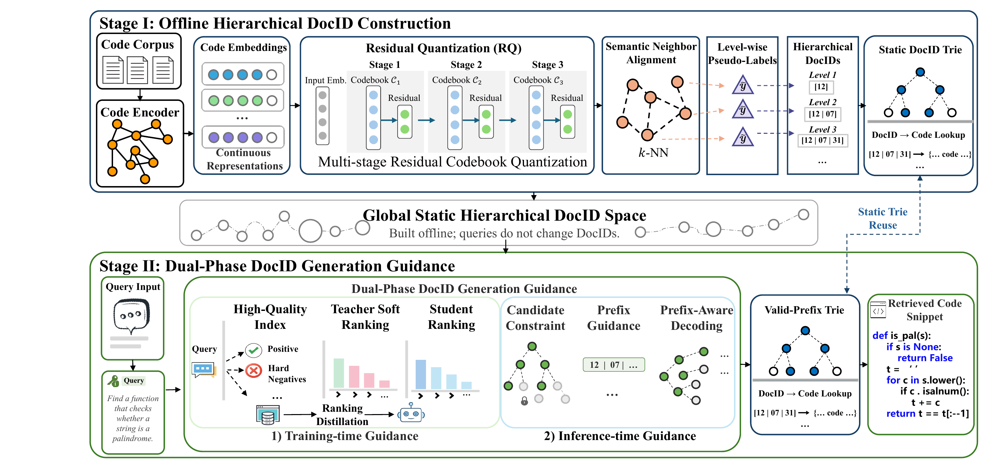

# CodeHID: Learning an Addressable Hierarchical Code Index for Generative Code Retrieval

[📖 Paper](https://arxiv.org/abs/2608.24089) | [🚀 GitHub](https://github.com/KDEGroup/CodeHID)

## 📣 News

- CodeHID has been accepted to **WSDM 2027 Findings**.
- **[2026/08/25]** Our [preprint](https://arxiv.org/abs/2608.24089) is available on arXiv.

## 🔥 Overview

**CodeHID reformulates code retrieval as coarse-to-fine semantic address generation over a learned hierarchical code index.** Given a natural-language query, it generates a hierarchical document identifier (DocID) that points to the target code snippet. Shared prefixes organize related snippets into semantic regions, while deeper tokens distinguish individual implementations.



*Overview of CodeHID. Stage I learns a globally static hierarchical DocID space. Stage II learns to navigate this space through training-time ranking enhancement and inference-time prefix guidance.*

CodeHID consists of two core components:

1. **Pseudo-Neighbor Guided DocID Learning.** We encode code snippets and apply multi-level residual quantization to construct hierarchical DocIDs. A $k$-NN graph provides level-wise pseudo-supervision: semantic neighbors are encouraged to share prefixes at appropriate depths, while negative separation preserves the distinction between different targets. The resulting identifiers are built offline and remain fixed across queries.
2. **Dual-Phase DocID Generation Guidance.** During training, hard-negative mining, pairwise preference learning, and rank distillation improve discrimination among confusable DocIDs. During inference, query-relevant candidates define valid decoding paths, and prefix-level relevance scores guide beam search. The generated DocID is then resolved to its code snippet through the static lookup.

### Main Results

CodeHID achieves the following results on CoSQA and the Python/Java subsets of ProCQA (Table 1 of the paper):

| Benchmark | Hit@1 | Hit@3 | Hit@5 | MRR@20 |
| --- | ---: | ---: | ---: | ---: |
| CoSQA | 0.744 | 0.783 | 0.792 | 0.766 |
| ProCQA-Python | 0.597 | 0.773 | 0.828 | 0.706 |
| ProCQA-Java | 0.520 | 0.734 | 0.825 | 0.654 |

CodeHID obtains the best Hit@1 and MRR@20 across all three settings among the compared baselines. See the [paper](https://arxiv.org/abs/2608.24089) for the full comparison and ablation studies.

## Setup

```bash
git clone https://github.com/KDEGroup/CodeHID.git
cd CodeHID
pip install -r requirements.txt
```

The commands below illustrate the CoSQA workflow. Replace `/path/to/...` with your local dataset and checkpoint paths. Model names can be Hugging Face identifiers or local model directories; training model settings are defined in [codehid/configs/models/codehid_codebert.yaml](codehid/configs/models/codehid_codebert.yaml) and [train_configs/codehid_finetune.yaml](train_configs/codehid_finetune.yaml).

## Training

### Stage I: Build Hierarchical DocIDs

Prepare the CoSQA train/dev JSON files, then run:

```bash
export CODEHID_WORK_DIR="$PWD/stage1_docid_build/data/cosqa_docid_build"

bash stage1_docid_build/run_stage1_pipeline.sh \
  cuda:0 \
  "$CODEHID_WORK_DIR" \
  microsoft/graphcodebert-base \
  /path/to/cosqa_train.json \
  /path/to/cosqa_dev.json
```

The pipeline prepares positive query-code pairs, encodes the corpus, builds the pseudo-neighbor graph, trains the residual quantizer, and rewrites the data with hierarchical DocIDs. Pseudo-neighbor supervision is enabled by default with `k=8` and loss weight `0.03`.

The main outputs are:

```text
stage1_docid_build/data/cosqa_docid_build/
├── docs.jsonl
├── docs.emb-codebert.npy
└── final/
    ├── train.jsonl
    ├── valid.jsonl
    └── doc_index_to_docid.json
```

The embedding filename is `docs.emb-codebert.npy` even when GraphCodeBERT is used as the encoder. Keep the document order consistent between this embedding array and `doc_index_to_docid.json`.

See [Stage I documentation](stage1_docid_build/README.md) for additional settings.

### Stage II: Train the Query-to-DocID Generator

After Stage I, launch the provided three-GPU training script:

```bash
DATASET_FINAL_DIR="$CODEHID_WORK_DIR/final" \
CUDA_VISIBLE_DEVICES=0,1,2 \
bash run_3gpu.sh
```

The script uses [train_configs/codehid_finetune.yaml](train_configs/codehid_finetune.yaml) and enables training-side ranking guidance by default. Checkpoints are saved under `output/codehid_codebert_dsi/`.

## Inference

Evaluate a trained checkpoint with candidate constraints and prefix-aware decoding:

```bash
python eval.py \
  --ckpt-path /path/to/checkpoint.pth \
  --dataset-path "$CODEHID_WORK_DIR/final/valid.jsonl" \
  --docid-vocab-path "$CODEHID_WORK_DIR/final/doc_index_to_docid.json" \
  --dual-phase-guidance-infer-doc-emb-path "$CODEHID_WORK_DIR/docs.emb-codebert.npy" \
  --dual-phase-guidance-infer-doc-index-to-docid-path "$CODEHID_WORK_DIR/final/doc_index_to_docid.json" \
  --constrained-decode \
  --dual-phase-guidance-infer-enable \
  --dual-phase-guidance-infer-lexical-topk 3000 \
  --dual-phase-guidance-infer-lexical-bonus-weight 0.10 \
  --num-beams 20
```

This example evaluates the prepared development split. The beam size (`20`), candidate set size (`3000`), and prefix bonus weight (`0.10`) follow the paper's inference settings.

For concrete examples of shared-prefix branching and fine-grained candidate competition, see [Hierarchical DocID Generation Examples](examples/docid_generation_cases.md).

## ⭐️ Citation

If you find CodeHID useful in your research, please cite our paper:

```bibtex
@misc{li2026codehidlearningaddressablehierarchical,
  title={CodeHID: Learning an Addressable Hierarchical Code Index for Generative Code Retrieval},
  author={Zhen Li and Yuhong Chen and Wenhao Xu and Xiaodong Li and Hui Li},
  year={2026},
  eprint={2608.24089},
  archivePrefix={arXiv},
  primaryClass={cs.IR},
  url={https://arxiv.org/abs/2608.24089}
}
```
